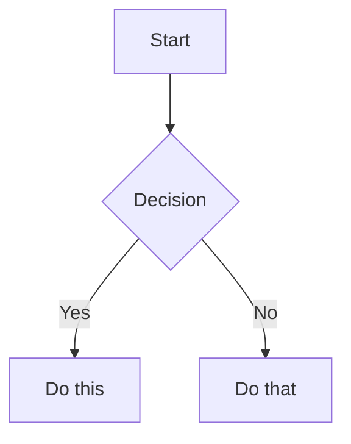

# Obsidian Flavored Markdown Skill

Create and edit valid Obsidian Flavored Markdown. Obsidian extends CommonMark and GFM with wikilinks, embeds, callouts, properties, comments, and other syntax. This skill covers only Obsidian-specific extensions -- standard Markdown (headings, bold, italic, lists, quotes, code blocks, tables) is assumed knowledge.

## Proactively Offer Knowledge Capture

After completing a substantive explanation of a project's implementation principles, architecture, features, data flow, or a reusable technical workflow, offer once to save it to Obsidian, even when the user did not mention Obsidian. A detailed follow-up such as “说详细一点” is a useful checkpoint; wait until the explanation is complete instead of interrupting it.

- Use a short optional question, preferably the available asynchronous question tool: “需要把这份说明整理到 Obsidian 吗？” Suggest a concrete note title when helpful.
- Offer for explanations with lasting reference value. Skip simple factual answers, routine status reports, short command help, and intermediate progress updates.
- Ask at most once per topic. Do not repeat after refusal, while the question is pending, or after an unanswered offer unless the user brings it up again. Respect requests to stop offering.
- An offer does not authorize a vault write. Save after the user accepts; if they already requested saving, proceed without asking again.
- Do not require a configured vault merely to offer. After acceptance, use `obsidian-cli` when available to discover the active vault. If the app/CLI is unavailable, use a verified filesystem vault path. Ask only for a missing target that cannot be discovered; never guess a vault or claim a note was saved before verifying the write.
- Capture the useful explanation with frontmatter, suitable headings, callouts, and diagrams. Include source/version/date and separate verified behavior from estimates or unresolved points. Link existing related notes when verified; avoid invented links. Do not copy credentials or unrelated conversation history.
- “保存到 OB” means writing to the selected vault. Do not imply cloud upload or enable synchronization without the user's instruction.

## Resolve the User's Existing Vault Before Writing

For requests to save or upload notes to OB, check `obsidian-troubleshooting/references/local-vault.md` when that installed skill is available. Its confirmed vault and sync preferences apply to knowledge notes as well as incident notes. Resolve the target in this order: the user's explicit current destination, confirmed saved preferences, then registered Obsidian vault candidates. A recently opened or newly created vault must not override an existing confirmed destination.

Treat saved paths, tools, account access, and client versions as device-specific observations: verify them on the current machine. If the preferred local path belongs to another OS but a remote repository is specified, retain that repository as the intended destination and check access before preparing a local checkout. Do not switch to an unrelated empty vault or propose official Sync when saved preferences choose GitHub. Follow the saved Git sync workflow and authorization scope; report local save and remote upload separately. If authentication blocks access, preserve the prepared note and identify the required account/repository access without claiming an upload succeeded.

## Workflow: Creating an Obsidian Note

1. **Add frontmatter** with properties (title, tags, aliases) at the top of the file. See [PROPERTIES.md](references/PROPERTIES.md) for all property types.
2. **Write content** using standard Markdown for structure, plus Obsidian-specific syntax below.
3. **Link related notes** using wikilinks (`[[Note]]`) for internal vault connections, or standard Markdown links for external URLs.
4. **Embed content** from other notes, images, or PDFs using the `![[embed]]` syntax. See [EMBEDS.md](references/EMBEDS.md) for all embed types.
5. **Add callouts** for highlighted information using `> [!type]` syntax. See [CALLOUTS.md](references/CALLOUTS.md) for all callout types.
6. **Verify** the note renders correctly in Obsidian's reading view.

> When choosing between wikilinks and Markdown links: use `[[wikilinks]]` for notes within the vault (Obsidian tracks renames automatically) and `[text](url)` for external URLs only.

## Internal Links (Wikilinks)

```markdown
[[Note Name]]                          Link to note
[[Note Name|Display Text]]             Custom display text
[[Note Name#Heading]]                  Link to heading
[[Note Name#^block-id]]                Link to block
[[#Heading in same note]]              Same-note heading link
```

Define a block ID by appending `^block-id` to any paragraph:

```markdown
This paragraph can be linked to. ^my-block-id
```

For lists and quotes, place the block ID on a separate line after the block:

```markdown
> A quote block

^quote-id
```

## Embeds

Prefix any wikilink with `!` to embed its content inline:

```markdown
![[Note Name]]                         Embed full note
![[Note Name#Heading]]                 Embed section
![[image.png]]                         Embed image
![[image.png|300]]                     Embed image with width
![[document.pdf#page=3]]               Embed PDF page
```

See [EMBEDS.md](references/EMBEDS.md) for audio, video, search embeds, and external images.

## Callouts

```markdown
> [!note]
> Basic callout.

> [!warning] Custom Title
> Callout with a custom title.

> [!faq]- Collapsed by default
> Foldable callout (- collapsed, + expanded).
```

Common types: `note`, `tip`, `warning`, `info`, `example`, `quote`, `bug`, `danger`, `success`, `failure`, `question`, `abstract`, `todo`.

See [CALLOUTS.md](references/CALLOUTS.md) for the full list with aliases, nesting, and custom CSS callouts.

## Properties (Frontmatter)

```yaml
---
title: My Note
date: 2024-01-15
tags:
  - project
  - active
aliases:
  - Alternative Name
cssclasses:
  - custom-class
---
```

Default properties: `tags` (searchable labels), `aliases` (alternative note names for link suggestions), `cssclasses` (CSS classes for styling).

See [PROPERTIES.md](references/PROPERTIES.md) for all property types, tag syntax rules, and advanced usage.

## Tags

```markdown
#tag                    Inline tag
#nested/tag             Nested tag with hierarchy
```

Tags can contain letters, numbers (not first character), underscores, hyphens, and forward slashes. Tags can also be defined in frontmatter under the `tags` property.

## Comments

```markdown
This is visible %%but this is hidden%% text.

%%
This entire block is hidden in reading view.
%%
```

## Obsidian-Specific Formatting

```markdown
==Highlighted text==                   Highlight syntax
```

## Math (LaTeX)

```markdown
Inline: $e^{i\pi} + 1 = 0$

Block:
$$
\frac{a}{b} = c
$$
```

## Diagrams (Mermaid)

````markdown

````

To link Mermaid nodes to Obsidian notes, add `class NodeName internal-link;`.

## Footnotes

```markdown
Text with a footnote[^1].

[^1]: Footnote content.

Inline footnote.^[This is inline.]
```

## Complete Example

````markdown
---
title: Project Alpha
date: 2024-01-15
tags:
  - project
  - active
status: in-progress
---

# Project Alpha

This project aims to [[improve workflow]] using modern techniques.

> [!important] Key Deadline
> The first milestone is due on ==January 30th==.

## Tasks

- [x] Initial planning
- [ ] Development phase
  - [ ] Backend implementation
  - [ ] Frontend design

## Notes

The algorithm uses $O(n \log n)$ sorting. See [[Algorithm Notes#Sorting]] for details.

![[Architecture Diagram.png|600]]

Reviewed in [[Meeting Notes 2024-01-10#Decisions]].
````

## References

- [Obsidian Flavored Markdown](https://help.obsidian.md/obsidian-flavored-markdown)
- [Internal links](https://help.obsidian.md/links)
- [Embed files](https://help.obsidian.md/embeds)
- [Callouts](https://help.obsidian.md/callouts)
- [Properties](https://help.obsidian.md/properties)
