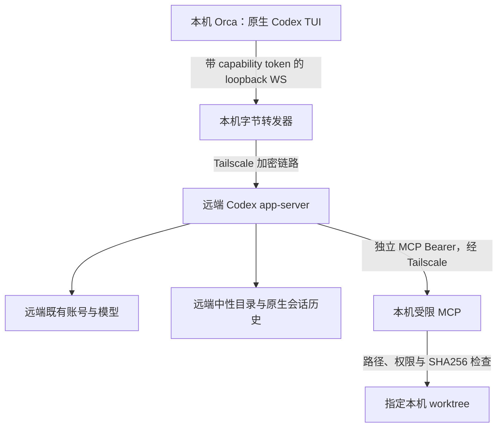

# Orca + Tailscale 远端角色操作手册

> 技能按运行程序（Codex/OMP）、角色、远端环境、本机工作区分别路由。本文第 1 节及第 3–14 节记录已验收的原生 Codex 接入；OMP 分支见第 2.2 节，不能将 Codex 历史证据或专用启动命令套用到 OMP。本文不是安装器，不自动升级软件、不同步仓库、不迁移模型凭据。

## 1. 先理解真实能力边界

本方案有三条不同链路，不要混用：

1. **Orca 控制平面**：本机 Orca → 已保存 environment → 远端 Orca。用于发现、查看、启动和聚焦指定终端；environment 名称不是模型名称，也不是工作区路径。
2. **Codex 会话链路**：本机官方 Codex TUI → 本机 loopback 转发 → Tailscale → 远端官方 Codex app-server → 远端既有模型供应商。`native_codex.py` 只启动官方进程和转发字节，不自己转发每轮对话。
3. **本机项目工具链路**：远端 app-server → Tailscale → 本机受限 HTTP MCP → 本机指定 worktree。源码仍在本机，模型通过明确工具取回允许的文本。



**这不是本机文件系统挂载。** TUI 的目录、`@` 文件选择、`!` Shell 上下文属于远端中性控制目录，不会自动指向本机项目；Shell 工具在此配置中被禁用。要读写本机源码，必须使用 `worktree` MCP。当前未提供任意本机 Shell、构建、测试、安装依赖、删除文件、创建目录、跨工作区操作或生产运维能力。

“源码不复制”指不做 clone/rsync/整仓镜像；允许读取的源码内容仍会进入远端模型上下文。不要将该方案描述为数据不出机或经过安全认证的隔离沙箱。`send_role` 能委托既有可信 agent，不能当作操作系统级沙箱。

官方将 app-server WebSocket 标记为实验性、不支持生产工作负载。本文的成功演练不改变这一支持等级，也不等于原生完整本机开发环境已跨主机迁移。

## 2. 技能入口与角色选择

在**具备本机 Orca CLI 与文件工具权限的本机管理 AI 对话**中调用（本机 Codex/OMP）；不是在只具备 worktree MCP 的受限远端角色中执行宿主管理：

```text
$orca-remote -codex master
$orca-remote -omp designer
$orca-remote -codex master --environment <已保存的远端名称> --worktree <本机工作区绝对路径>
$orca-remote --to-agent <实际存在的agent终端句柄>
```

`$orca-remote` 是让 AI agent 加载技能的语法，不是 shell 环境变量；本文没有安装或注册全局 `orca-remote` 可执行文件。不要把上面的文本直接当 shell 命令执行。

- `-codex <role>`、`-omp <role>`、`--to-agent <handle>` 三选一；最后一种只连接已有 agent，不创建或改角色。运行程序、角色、模型 provider 与终端承载 environment 分别核对。重复/未知参数、混用目标和缺失值必须拒绝。
- environment/worktree 缺省时，先从当前工作区、明确绑定和实时发现中唯一确定；有歧义就报告需要选择的一个具体范围，不能任取第一个服务器或工作区。
- 默认双向交接当前工作的最新上下文，既包括本机切远端，也包括远端切回已有 agent；`--no-handoff` 才是仅打开/聚焦。原始历史原地保留，不是完整会话迁移。具体流程、私密记录与回执依据见 [双向任务上下文交接](handoff.md)。
- `orca-team` 菜单 remote/off 已接入带源绑定的持久交接；`remote-status` 查询确认归属与 pending，`off` 交回原本本机会话，目标回执校验通过后才提交切换。协调者必须沿用菜单 intent 的 taskId/ledgerDirectory 并执行 remote-commit，详见 [菜单接入](handoff.md#7-orca-team-菜单接入)。
- 角色来自当前项目 `.orca/team.json`（如存在）、团队 `team.json`、`layout.json` 和对应 `source/` 资源。`coder` 是分组，不应凭分组名伪造一个同名角色。
- 当前团队配置存在 `master`、`loader`、`archi`、`coder1`、`coder2`、`designer`、`reviewer`、`test`、`simple`、`deploy`。实际运行时重新读取配置；此清单不是永久授权清单。
- `master`/`loader` 对应 `agentroles.ccb_self`，coder1/coder2 对应 `agentroles.coder`，reviewer/test 对应 `agentroles.code_reviewer`。复用真实角色职责，不能拿 master 的配置、提示词和 token 改标题冒充另一角色。
- 当前 master 对指定 worktree 的源码读写已获授权，不代表其他角色、其他 worktree 或生产部署也自动获授权。`deploy` 角色的存在不授予本链路任意远端生产权限。

### 2.1 技能安装与生效

本机技能真源为 `~/.codex/skills/orca-remote/SKILL.md`，本手册位于同目录的 `references/operations.md`。OMP 的 `~/.omp/agent/skills/orca-remote` 是指向同一目录的链接，避免维护两份技能。官方本机 Codex `skills/list` 已发现 `name=orca-remote, enabled=true, scope=user`；OMP 目录链接已建立，但本次未另启 OMP 会话验证其加载。

新开本机 Codex/OMP 会话后使用技能；正在运行的会话不保证自动刷新技能清单。`codex --remote` 使用远端运行环境，本机安装不会自动同步到远端。本技能未给受限远端角色增加本机 Orca CLI 或任意 Shell 权限。

迁移安装时需要同时准备技能目录、既有团队角色资源，以及经审阅的三个 helper 源文件；不能只复制 SKILL.md 就宣称已具备运行条件。不要复制 runtime、provider 凭据或会话历史。只建立缺失的目录/链接，已有不同技能不得直接覆盖。

### 2.2 OMP 运行程序分支

```text
$orca-remote -omp designer
$orca-remote -omp designer --environment claude --worktree /path/to/worktree
```

这表示在选定远端主机运行 **OMP** 并加载真实 **designer** 角色，不表示使用名为 OMP 的模型，也不复用 Codex master 的身份或默认模型。复用键包含运行程序、角色、environment 和本机 worktree；健康的同范围实例优先复用。

2026-10-14 已实测本机 OMP `18.10.3` 与远端 `18.10.2`，`master`、`archi` 使用远端既有 `pay/gpt-6-astra`。这是这两个角色和当前主机的证据，不代表 designer 或所有模型已验收。

实现位于团队包 `remote-master/`：`omp_adapter.py` 编排、`native_omp.py` 原生 host/join、`private_collab_relay.ts` 私网 relay、`collab_tunnel.py` 两端 loopback 转发、`omp_control.py` 私有状态/回复读取，以及既有 `bridge.py` 本机 worktree MCP。无需复制仓库；远端保留模型账号，按实际角色资源创建独立控制目录。

#### 确定性接入，不再现场研究协议

正式切换使用技能或 `orca-team` 菜单。以下是管理端调用同一适配器的检查入口；**仅确保接入，不执行任务交接，也不改变负责人**。`ROLE` 必须是配置里的真实角色，模型/thinking 从该角色保存的选择读取；不从 master 抄给其他角色。

```sh
WORKTREE=/path/to/worktree
ROLE=master
ENVIRONMENT=claude
node --input-type=module - "$WORKTREE" "$ROLE" "$ENVIRONMENT" <<'JS'
import fs from 'node:fs';
import os from 'node:os';
import path from 'node:path';
import { pathToFileURL } from 'node:url';
const home = path.join(os.homedir(), '.orca/roles/ccb-team');
const { ensureOmp, ompSelection, validateOmpEndpoint, verifyOmpBinding } =
  await import(pathToFileURL(path.join(home, 'lib/omp-adapter.mjs')));
const { orca } = await import(pathToFileURL(path.join(home, 'lib/orca.mjs')));
const [worktree, role, environment] = process.argv.slice(2);
const request = { home, project: fs.realpathSync(worktree), role,
  ...ompSelection(home, role), ...(environment ? { environment } : {}) };
const endpoint = await ensureOmp(request);
await validateOmpEndpoint(endpoint, request, orca);
await verifyOmpBinding({ home, project: request.project, role,
  config: endpoint.adapterConfig, endpoint });
console.log(JSON.stringify(endpoint));
JS
```

底层接口为 `python3 <团队包>/remote-master/omp_adapter.py ensure --request <0600 JSON>`；请求字段是 `home/project/role/model/thinking`，可选 `environment`。运行目录键为规范本机 project 与 role 的 SHA256 前 16 位；实际远端 environment 和模型不能隐式替换。thinking 是可变的会话设置：已有实例保持同一身份，在空闲、空输入框及原生状态可验证时按用户菜单选择对齐；不新建会话。返回本机 terminal/incarnation 与真实远端 session，不包含令牌。

私有绑定保存于 `remote-master/runtime/omp-<id>/adapter.json`，目录 0700、文件 0600，**该文件包含控制凭据，禁止整份输出**。只需核验既有链路时执行：

```sh
python3 "$HOME/.orca/roles/ccb-team/remote-master/omp_adapter.py" verify --config "$ADAPTER_CONFIG"
```

`verify` 返回非秘密 endpoint。模型匹配不等于上游永远可用；新实例仍需真实模型响应和 MCP 文件访问证据。当前依赖已安装的 OMP、Python、Bun 和已连接的 Orca/Tailscale，不自动安装、登录或复制密钥。

#### 安全、续接和失败处理

- 私网 relay 按来源地址及 Bearer 摘要验证；两端仅以 loopback URL 加入。控制邀请链接同样是秘密，仅写私有文件；原生 `omp join` 必须在 argv 接收链接，因此不要采集/公开完整进程参数。未使用公网 relay、RPC UI 或逐轮 exec 控制台。
- host/guest 使用进程专属配置根、关闭环境插件和无关 MCP 自动发现，引用原有 auth/model 存储，不改用户全局配置。只有角色限定的本机 MCP 可用于项目操作；源码写入要求当前 SHA，越界、敏感文件、删除和任意 Shell 均不开放。`@` 和 Shell 不是本机文件系统挂载。
- 创建前持久写入意图；丢失创建回执、列表查询失败或身份不符时停止，不重复建角色。远端 host 故障不自动重启成新会话，不手改绑定来绕过核验。
- 健康实例复用。权威列表证明旧本机 guest 已关闭，且远端 PID/instance/generation/session/model 未变时，`ensure` 可重开 guest。菜单接手记录随后在共享账本锁下追加同-session `owner_rebindings`，原始回执和完整历史保持不变，下一次交接仍递增同一 task 的 revision。
- 控制服务只提供 `/health`、`/snapshot`、`/link`、`/messages`，须精确 peer 与 Bearer。`/messages` 通过 byte offset 读取完整的真实 assistant 文本，过滤 thinking/tool 内容；session 或文件变化拒绝读取。不要把终端输入回显或 `send accepted` 作为接受证据。投递前核对 `busy=false` 与空输入框；缺少证据不猜测 idle。
- 默认仍执行双向检查点/真实 accepted/归属提交；`off` 返回最初本机会话，不启动替身。未提交归属前，源端仍负责，目标不能擅自执行传入业务。
- thinking 对齐使用 host 的原生 `Shift+Tab`，不向模型发送猜测的 slash 命令。成功依据是绑定同一 host session 的本机 guest JSONL 中 `thinking_level_change`，不是终端图标或按键受理；当前要求唯一可识别副本，存在歧义时明确阻塞。未观察到按键结果时保留 `thinkingChange`，下一次先对账，禁止盲目再按。busy、非空/无法确认的输入框、身份变化或不支持的等级都不会触发会话重建。
- 菜单只显示白名单 readiness 原因，不输出底层 stderr、URL 或凭据。模型变更仍需显式迁移，不能与 thinking 变更混为一谈。
- 2026-10-14 实机修复验证：团队主工作区 master 从既有 medium 对齐至 xhigh，PID/session/instance/generation 均保持不变；重复 ensure 复用同一端点。适配器 14 项、菜单 36 项定向回归通过。这只证明设置及接入，不代替业务交接 accepted/remote-commit。
- 同日团队主工作区 master 的实际业务上下文交接已完成：同一 task 推进至 revision 2，真实远端助手返回 `HANDOFF_ACCEPTED`，`remote-commit` 校验通过，菜单 owner/runtime 已更新且 pending 清空。原 host session 与 xhigh 保持，原本机 source 继续暂停，archi 归属未改变。协调者首次因缺少面板字段中止后，使用正式原生进程/会话 helper 和已渲染空 composer 补齐证据，继续同一 intent，没有重建目标或伪造回执。
- 辅助终端自动收尾：`lib/auxiliary-cleanup.mjs` 在 `remote-start.mjs` / `startup-repair.mjs` 创建成功后登记精确 handle/incarnation、项目及 intent/修复请求，启动不占 UI 标签的 Node 清理进程。所有关联交接均已结算（或精确修复请求为 completed）、项目无 pending、原生 TUI 空闲且无输入草稿、身份未变并排除服务子进程后，只关闭该终端 pane。角色端点和 adapter 服务绑定始终保护；不删除账本、回执、会话文件，不按名称批量关闭，不使用 `--all` 或 `--tab`。
- 清理检查最长等待 6 小时；无法确认、blocked/未决任务、草稿或服务子进程均保留，清理结果写入项目 `auxiliary-terminals/<handle>.json`，不把失败伪装成已关闭。当前 macOS 使用原生进程树验证；其他平台仅在 Orca 提供严格的无子进程证据时可关闭，未完成其他平台实机验收。2026-10-14 已实测自动移除 3 个已结算 remote-setup 和 1 个 completed repair；其余终端代际不变，master/archi 原生核验通过，归属账本字节不变；51 项定向回归通过。

#### 本轮实际验收

- master/archi 原生 TUI 通过真实远端模型读取本机 `package.json`；master 临时修改 `src/lib/useCountUp.ts`，拒绝 stale SHA 后恢复原文，前后 SHA256 完全一致。
- 隔离账本中，本机真实 OMP 源与远端 master 完成 revision 1/2 双向接受；原始标记和远端实测结果回到同一原生 source session/incarnation。期间关闭并重开 guest，远端 PID/session/instance/generation 不变，原始接受回执字节不变。未迁移现有业务角色任务。
- Python adapter/工具/隔离测试 74 项、菜单与归属回归 102 项、真实 socket relay 测试 7 项通过。现有 Codex 连接、全局插件/账号配置和业务代码保持原状。完整团队套件、Windows 与远端 host 崩溃恢复未在本轮实测。

## 3. 两端前提与支持范围

| 项目 | 本机 | 远端 |
| --- | --- | --- |
| Orca | 已安装、CLI 可用、runtime 可达、目标 worktree 已存在 | 已安装、runtime 在线、已有有效配对授权 |
| Tailscale | 在线，明确本机和 peer 的 tailnet 地址 | 同一可达 tailnet 或明确允许的共享网络，ACL/grants 允许所需方向 |
| Codex | 已有支持 `--remote` 和 token-env 参数的 CLI | 已有支持 app-server capability-token 的 CLI、有效登录及模型配置 |
| Python | 当前 helper 使用 Python 3.9+ 语法/API | 同左；helper 互相 import 的目录需在 `PYTHONPATH` |
| Shell | 当前 launcher 使用 `/bin/zsh` | 当前 launcher 通过既有登录 shell 的 `codex` 入口保留 provider/Node 设置 |
| 文件 | 本机源码、独立私密 runtime、现有角色资源 | 中性控制目录、所需 helper 和角色指令；不需要项目仓库 |
| 运行条件 | 不休眠、MCP 和转发器持续运行 | 不休眠、Orca 和 app-server 持续运行 |

本轮只验证 macOS → macOS。Linux/Windows 的 Orca/Tailscale 可有官方支持，但**当前含 `/bin/zsh` 的 launcher 并未跨 OS 验收**，不能直接宣称可运行；Windows 路径、Shell、文件权限和服务管理要另行适配并验收。

账号、SDK/CLI、provider 已由使用者配置；缺任何前提时报告准确缺项和受影响步骤，不自动登录、安装、升级、改系统代理或复制 `auth.json`、API key、私钥。

只读前提发现命令（分别在正确主机执行）：

```sh
command -v orca
command -v python3
command -v codex
orca --help
codex --version
codex --help
codex app-server --help
codex features list
```

核对 CLI 帮助确有 `--remote`、`--remote-auth-token-env`、`--ws-auth`、`--ws-token-sha256`；不能用“版本数字看起来足够新”代替参数能力核对。不要输出 shell 函数正文或整份 provider 配置来诊断，它们可能含秘密。

## 4. 配对与 Tailscale 排障

### 4.1 先保证主机路由正确

本机命令要明确清除可能继承的远端路由变量；远端命令必须显式指定 environment：

```sh
# 以下变量只是示例，先填入实际已确认值。
ENV_NAME='<已保存的远端名称>'
WORKTREE='<本机工作区绝对路径>'
PEER_IP='<远端 Tailscale IPv4>'

# 本机发现，不让父会话的远端路由污染结果。
env -u ORCA_ENVIRONMENT -u ORCA_PAIRING_CODE orca status --json
env -u ORCA_ENVIRONMENT -u ORCA_PAIRING_CODE orca host list --json
env -u ORCA_ENVIRONMENT -u ORCA_PAIRING_CODE orca environment list --json
env -u ORCA_ENVIRONMENT -u ORCA_PAIRING_CODE orca worktree show --worktree "path:$WORKTREE" --json

# 指定已保存 environment，不以本机绝对路径查询远端项目。
env -u ORCA_ENVIRONMENT -u ORCA_PAIRING_CODE orca status --environment "$ENV_NAME" --json
env -u ORCA_ENVIRONMENT -u ORCA_PAIRING_CODE orca terminal list --environment "$ENV_NAME" --json
```

`environment show/list` 的输出也要按最小字段呈现；如果版本输出连接 URL 或授权信息，不整段贴入聊天或日志。`--environment` 是已配对 runtime，不要误用为 `--worktree`、`--repo` 或默认本机路由。

### 4.2 尚未配对时

已有匹配配对就复用，不重新生成访问链接。确实没有时：

1. 远端 Orca 打开 **Settings → Remote Orca Servers → Advertise this app as a server → New Link**。
2. Connection address 选择远端 Tailscale 地址，不选 `127.0.0.1`；生成一次访问链接。
3. 本机在同一设置页 **Add Server**，输入明确名称，安全粘贴链接并 Connect。
4. 只把环境名称和连接成功状态写入记录，不记录完整 pairing URL。无需将 Advanced → Active Server 全局切到远端，本方案依赖显式路由。
5. 若经批准使用 CLI，官方形式是 `orca environment add --name <名称> --pairing-code <配对链接>`；配对链接是秘密，该形式会涉及命令历史/进程参数，优先使用界面，不把真实链接放入 AI 对话。

已有桌面 Orca 不需要再起 `orca serve`。只有明确采用 headless 模式且确认没有重复 runtime 时才按官方文档管理；不要为“修连接”另开一套服务器。

### 4.3 分层检查网络

```sh
tailscale status
tailscale ip -4
tailscale ping "$PEER_IP"
tailscale netcheck
```

macOS 的 CLI 若不在 PATH，已安装 App Store 版可以使用：

```sh
TAILSCALE_BE_CLI=1 /Applications/Tailscale.app/Contents/MacOS/Tailscale status
```

检查实际已安装位置；不因 PATH 缺项就安装第二个 Tailscale。`tailscale ping` 使用 DERP 中继也可能正常，直连不是唯一成功条件。确认设备在线、地址正确、ACL/grants、macOS 防火墙和双方睡眠状态。

继续分层区分：

- Tailscale 可达 ≠ Orca 已授权配对。
- Orca 可达 ≠ Codex app-server 已监听。
- TCP connect 成功 ≠ WebSocket Upgrade 成功。
- WebSocket `101` ≠ MCP 可用或模型调用成功。
- MCP `read_file` 成功 ≠ 源码写入/恢复已经验证。

HTTP/WS 走错系统代理可出现超时或莫名 HTML。当前 launcher 仅对子进程追加 peer/bind、客户端 loopback 的 `NO_PROXY`/`no_proxy`；模型 provider 出站保持既有设置。bridge 自己的 HTTP 请求禁用代理。不要全局清代理，也不要扩大成所有目的地址直连。

## 5. 复用优先：先发现，后决定

每次技能调用均先做以下判定，不因为用户再次输入调用就重启。

1. 读取 `remote-master/runtime/session-bindings.json` 中目标身份的最小元数据；不要读取/打印整个 runtime 目录的 JSON。绑定只是索引，不是存活证明。
2. 对照 `(provider=codex, role, environment, 本机 worktree 规范化绝对路径)`，再核对 peer/bind、控制目录、源码权限和端口。
3. 本机 `terminal list --worktree path:...`，远端 `terminal list --environment ...`；若返回 truncated 或不完整，补全清单，不能由缺失结果判断不存在。
4. 用 `terminal show/read` 核实实际句柄、标题、`agentIdentity`、connected/writable、所属工作区和启动上下文；标题相同不够。远端 support terminal 可挂在远端已存在 worktree，但进程 cwd 必须是中性 control_dir，不能在该远端项目执行任务。
5. 核对 MCP `/health`、app-server 健康端点及握手身份，必要时查看 TUI `/status` 和 MCP `workspace_info`，确保不是别的端口/角色占用。
6. 全部匹配且健康：复用本机客户端，不新建、不重启、不新开原生线程；按 [双向交接流程](handoff.md) 获取最近接手方的新进展，目标确认后再聚焦，分开报告连接与交接状态。仅显式 `--no-handoff` 时只聚焦。直接点击 Orca tab 不经过技能，不自动交接。
7. 部分缺失：仅恢复证明确实缺失的组件。身份冲突、端口占用来源未知、授权范围变化时先报告，不接管别角色的服务。

聚焦示例，`CLIENT_HANDLE` 必须来自本次实时发现：

```sh
env -u ORCA_ENVIRONMENT -u ORCA_PAIRING_CODE orca terminal show --terminal "$CLIENT_HANDLE" --json
env -u ORCA_ENVIRONMENT -u ORCA_PAIRING_CODE orca terminal switch --terminal "$CLIENT_HANDLE" --json
```

## 6. 配置字段、两类 token 与保密

建议每个角色/environment/worktree 使用独立、不含秘密的实例名，例如 `<role>-codex-remote-<scope>`。下表是实际 helper 字段，不是全局 Orca 设置。

### 6.1 本机 `tools.json`（bridge.py local）

| 字段 | 含义 |
| --- | --- |
| `bind` / `peer` | 本机/远端 Tailscale IPv4；仅绑定本机 tailnet 地址，拒绝其他来源 |
| `port` | 独立 MCP 端口 |
| `root` | 授权的本机 worktree 绝对路径 |
| `orca` | 本机已发现的 Orca CLI 绝对路径 |
| `role` | 清晰标识角色的实例身份 |
| `token` | 此 MCP 实例专用随机 Bearer，只在私密配置/进程环境中使用 |
| `role_prompt` | 真实既有角色指令加本次远端工具边界，不能包含 provider 凭据 |
| `code_write_enabled` | 明确布尔授权；新范围不默认开启源码写入 |
| `excluded_handles` | 排除自身客户端、support terminals 等不应接收委托的句柄 |
| `bootstrapped` | 一次性 bootstrap 是否已消费；完成后应为 true |

### 6.2 本机 `native.json`（client / tunnel）

| 字段 | 含义 |
| --- | --- |
| `peer` | 远端 app-server 的 Tailscale IPv4 |
| `role` | 本次真实角色实例标签；新角色必须显式设置，不能沿用默认 master 标签 |
| `native_port` | 远端 app-server 端口；默认 18766，与远端配置一致 |
| `tunnel_port` | 本机 loopback 转发端口；默认 18767 |
| `url` | `ws://127.0.0.1:<tunnel_port>`，必须与实际转发端口一致 |
| `remote_cwd` | 远端已经存在的中性 control_dir 绝对路径，不是本机 root |
| `token` | 独立原生会话 capability token，不与 MCP token 或别角色 token 共用 |

客户端把 capability token 放入 `MASTER_CODEX_REMOTE_TOKEN`，只将环境变量名传给 Codex；转发器不移除鉴权、不记录会话内容。使用配置端口前核对安装的 launcher 已支持 `native_port`/`tunnel_port`；旧版本固定端口不能承载第二实例，应报告前提不满足，不静默共用 master 端口。

### 6.3 远端 `engine.json`（native server）

| 字段 | 含义 |
| --- | --- |
| `bind` / `peer` | 远端/本机 Tailscale IPv4，方向与 tools.json 相反 |
| `role` | 与该角色实例身份及 role_prompt 一致的标签 |
| `native_port` | 与本机 native.json 一致的 app-server 端口 |
| `control_dir` | 专属中性目录，保存本实例控制状态，不放项目仓库 |
| `local_url` | `http://<本机 Tailscale IP>:<MCP_PORT>`，不带 `/mcp`；launcher 会追加 |
| `token` | 仅 MCP Bearer，远端必须持有它才能调用本机 MCP；不是原生 capability token |
| `role_prompt` | 与本机该角色授权一致的实际角色内容 |
| `code_write_enabled` | 与本机 MCP 授权一致，决定 app-server 是否列出源码写工具 |
| `supported_features` | 从该远端已安装 Codex 的 features 列表确认的名称；不能凭空列出 |

server 启动参数 `--token-sha256` 接收原生 capability token 的 64 位十六进制 SHA256。**远端只需原生 token 的摘要，但需要 MCP token 原文**，两者不能混淆。`port`、`remote_url`、`session.json`、`session-code.json` 等旧 exec/console 字段不等于原生服务端口或原生会话恢复入口。

### 6.4 保密要求

- runtime/control 目录 0700，含秘密文件 0600；只用安全生成器（例如 Python `secrets.token_urlsafe(48)`）生成高熵值，不用口令或可猜实例名。
- 原生和 MCP token 独立，每个角色实例再独立；不要输出 token、完整配置、环境变量全集、provider 响应或 pairing URL。
- `bridge.private_json()` 可安全写入 0600 文件，但它会替换已有文件；首次创建前必须确认目标不存在，不能借此覆盖健康实例或轮换当前凭据。
- 本机 `MASTER_CODEX_REMOTE_TOKEN` 与远端 `MASTER_WORKTREE_MCP_TOKEN` 只属于对应子进程，不写入 shell profile，不放命令参数。
- 仅复制 helper 源码及经核准的角色指令，绝不复制仓库、模型账号配置、私钥、用户 home 或 runtime 秘密目录。

## 7. 从零接入：只在确认无可复用实例后进行

以下是有明确新接入授权时的步骤，不是每次调用的默认操作。示例占位值必须先替换，不能原样运行；所有创建均要使用独立目录、端口和角色身份。

### 7.1 确定实例和已授权权限

1. 解析真实角色、environment、本机 worktree，并核对角色 source、generated prompt。生成文件里若引用本机绝对路径，不能让远端假装能访问这些路径；把需要的既有角色内容安全组合进 `role_prompt`，明确其资源基准和工具边界。
2. 角色指令须明确：模型在远端；项目只经 MCP；没有任务时等待；不自动向本机 master 发任务；`send_role` 仅用于用户明确授权且本次实时发现的既有角色。
3. 分配独立 MCP/native/tunnel 端口；先核对监听归属，不占用其他角色的现有端口。在各自 Mac 可用 `lsof -nP -iTCP:<端口> -sTCP:LISTEN` 做只读检查。无输出只代表当时未发现监听，不能保证后续没有竞争。
4. 独立目录建议：本机 `~/.orca/roles/ccb-team/remote-master/runtime/<实例>/`；远端 `~/.orca/<实例>/`。实际 root/control_dir 使用解析后的绝对路径。
5. 确认本机有 `bridge.py`、`codex_engine.py`、`native_codex.py`，远端 helper 目录有同一受审版本。只通过已有授权传输通道传这三个源码文件；不为此启用 SSH、Funnel 或新的公网入口。没有可用传输能力就报告该缺项，不以复制整个用户目录替代。

### 7.2 创建本机私密配置

在本机受控 Python 进程中使用 `secrets` 生成两枚独立 token，通过 `private_json` 写入上述 schema；不要把它们打印到聊天。以下片段展示核心写法，运行者需先按第 6 节完整组装非秘密字段字典：

```python
from pathlib import Path
import hashlib
import secrets
from bridge import private_json

# runtime、tools_fields、native_fields 均先由已确认的实例/角色配置构造。
# tools_fields 包含第 6.1 节全部字段，bootstrapped=False；
# native_fields 包含第 6.2 节除 token 外全部字段。
runtime = Path(runtime).expanduser()
if runtime.exists():
    raise RuntimeError("实例目录已存在：返回复用/恢复流程，不覆盖")
runtime.mkdir(parents=True, mode=0o700)
mcp_token = secrets.token_urlsafe(48)
native_token = secrets.token_urlsafe(48)
private_json(runtime / "tools.json", {**tools_fields, "token": mcp_token})
private_json(runtime / "native.json", {**native_fields, "token": native_token})
private_json(runtime / "capability-verifier.json", {
    "sha256": hashlib.sha256(native_token.encode()).hexdigest()
})
# 不打印 token；远端只需 capability-verifier.json 中的摘要。
```

这段是配置创建接口示例，不是填入模糊默认值的一键安装脚本。`tools_fields` 的每个值必须有第 7.1 节的来源；`code_write_enabled` 不得由角色名字猜测。若无需 bootstrap，应通过已有安全通道配置 MCP token 并直接把 `bootstrapped` 设为 true，不能无理由保留 bootstrap 窗口。

### 7.3 启动本机 MCP，再一次性配给远端

在**本机专属 support terminal**运行：

```sh
python3 "$ADAPTER/bridge.py" local --config "$RUNTIME/tools.json"
```

其中 `ADAPTER` 为 helper 目录，`RUNTIME` 为本机实例目录。前台 support terminal 要保留，不把命令粘进正在运行的 Codex TUI。

首次 bootstrap 是受 peer IP 限制的一次性交换：远端受控 Python 调用 `bridge.request(local_url + '/bootstrap', data={})`，将返回的 MCP token、role_prompt、local_url、peer **直接留在进程内**，补全第 6.3 节字段后用 `private_json(engine_path, cfg)` 写 0600 的 engine.json；禁止 `print(cfg)`。这不是原生会话 token 的传递。

```python
from bridge import request, private_json

# 在远端执行；local_url、engine_path、server_fields 已按第 6.3 节确认。
# server_fields 包括远端 bind、native_port、control_dir、supported_features、
# 与本机明确一致的 code_write_enabled；不得覆盖 bootstrap 的身份/token。
if engine_path.exists():
    raise RuntimeError("远端配置已存在：先核对复用，不覆盖")
cfg = request(local_url + "/bootstrap", data={})
cfg.update(server_fields)
private_json(engine_path, cfg)
```

不要运行 `bridge.py bootstrap` 来创建 Codex 实例：该历史命令会创建固定 Claude 控制目录并启动 Claude transport，不是通用的原生 Codex 初始化器。若 bootstrap 响应丢失，先查本机是否已标记完成及远端文件是否已创建，不盲重置或重发；无法恢复秘密交付时，按明确授权对这一实例重新配给，不能触碰其他角色。

### 7.4 启动远端原生 app-server

在**远端专属 support terminal**，变量均指向远端路径：

```sh
PYTHONPATH="$REMOTE_ADAPTER" python3 "$REMOTE_ADAPTER/native_codex.py" server \
  --config "$REMOTE_CONTROL/engine.json" --token-sha256 "$CAPABILITY_SHA256"
```

`CAPABILITY_SHA256` 只含本机生成的原生 token 摘要，不含 token 原文；从安全记录取得摘要，不读取/复制本机 native.json 全文。launcher 复用远端既有 `codex` shell 入口，但显式限定远端只读 sandbox、审批策略、唯一 worktree MCP 和可禁用的 Shell/exec/patch/multi-agent/hooks 等 features。

先核对远端当前 features 确实支持所需限制，尤其 `shell_tool`。不支持就报告无法强制该边界，而不是带着任意 Shell 权限启动。角色提示词不替代工具层和本机 bridge 的限制。

### 7.5 启动本机转发器和客户端

分别在两个**本机独立终端**中运行：

```sh
# 保持运行的 support terminal：
python3 "$ADAPTER/native_codex.py" tunnel --config "$RUNTIME/native.json"

# 可见的原生 Codex 终端：
python3 "$ADAPTER/native_codex.py" client --config "$RUNTIME/native.json"
```

Orca 创建终端的官方形式如下，`LAUNCH_COMMAND` 只包含正确引用的程序/配置路径，不含 token：

```sh
# 本机实例终端
env -u ORCA_ENVIRONMENT -u ORCA_PAIRING_CODE orca terminal create \
  --worktree "path:$WORKTREE" --title "$INSTANCE_TITLE" --command "$LAUNCH_COMMAND" --json

# 远端 support terminal；REMOTE_WORKTREE 是远端实时发现的既有容器工作区。
env -u ORCA_ENVIRONMENT -u ORCA_PAIRING_CODE orca terminal create \
  --environment "$ENV_NAME" --worktree "$REMOTE_WORKTREE" \
  --title "$REMOTE_INSTANCE_TITLE" --command "$REMOTE_LAUNCH_COMMAND" --json
```

若创建报错、超时或输出不可解析：**先 list/show 查是否已创建成功，禁止立即再次 create**。终端创建成功但命令失败，也应修复该精确实例，而不是堆叠同名 tab。

### 7.6 记录非秘密绑定

成功发现并验收后，把实际 provider、角色、environment、worktree、两端 IP、端口、权限级别、配置路径、control_dir、实时 terminal handles、原生 session ID 和验收时间写入既有 `session-bindings.json` 的适用结构。先读既有结构，保留 Claude/其他角色及旧历史，不重新发明一份冲突索引。

禁止记录 token、完整 prompt、配对 URL 或模型凭据。句柄会过期，每次恢复都要重新验证。新增 support/client 句柄及时纳入该实例的 `excluded_handles`，避免自发委托循环；生效涉及正在运行 bridge 配置时，须安排该实例的有授权重载，不能冒充热生效。

## 8. 为什么必须原生鉴权和 loopback 转发

官方客户端限制非 loopback 的明文 WebSocket Bearer 使用；远端连接应使用 TLS。当前专用部署采用：本机 `127.0.0.1` 明文 WS → 本机转发器 → **Tailscale 加密网络** → 远端 Tailscale 地址上的鉴权 app-server。

- loopback 只在本机监听，不绑定 `0.0.0.0`、局域网或公网。
- 转发器只转发 TCP 字节，真正的 capability-token 验证仍由远端 app-server 在 WebSocket Upgrade 时执行。
- 远端 app-server 必须启用 `--ws-auth capability-token`，不能仅凭“只有 tailnet 能连”就关闭鉴权。
- SHA256 是 verifier，不是可用于登录的 token；客户端仍需原文。不要把低熵口令哈希当 capability token。
- 本方案是 tailnet 专用转发适配，并非官方文档所举 SSH 转发的逐字实现；安全前提是双方可信且所有跨机字节确实走 Tailscale。迁出 tailnet 时不能照搬，需重新设计受认证 TLS。
- 不使用公开 Funnel，不开启新的 SSH 服务，不把 Orca/app-server/MCP 端口映射到公网。

## 9. MCP 权限与操作规则

| 工具 | 实际能力与限制 |
| --- | --- |
| `workspace_info` | 返回精确本机 root、分支、HEAD、角色、写权限、arbitrary_shell=false |
| `list_files` | 非敏感已跟踪文件；启用源码写后也包含非 ignored 的未跟踪文件；最多 600 项且报告 truncated |
| `read_file` | UTF-8 文件、最多 1 MiB，单次 1–300 行，返回整文件 SHA256 |
| `write_document` | 仅 docs/ 或 .codex/ 下 Markdown；须 latest SHA256，新文件用 absent |
| `write_file` | 仅显式 code_write_enabled；现有目录内创建/替换非敏感、非 ignored UTF-8 文本 |
| `edit_file` | 同上；old_text 必须恰好出现一次；保留其他字节 |
| `list_roles` | 仅该本机 worktree 的完整实时终端清单，不创建角色 |
| `read_role` | 仅本次证明存在且允许的 agent 终端；不读普通 shell/其他工作区 |
| `send_role` | 仅已获用户明确授权的任务，发送到本次核实的既有 agent handle |

写入最大 512 KiB；禁止 stale SHA、歧义替换、符号链接、硬链接写入、二进制、越界路径、秘密文件、ignored 文件、CI/agent-policy 源码写、删除和任意 shell。`deploy/`、`storage/`、`.git/`、`.orca/`、`.env*`、`docker-compose*` 等被路径规则拦截。

有些被跟踪项目文件本身仍可能包含敏感业务内容；过滤器不是通用秘密识别器，操作者仍须遵守用户授权。`write_document` 是协调文档权限，不应借可写 Markdown 注入新的 agent 权限。

`Read Only (Ask for approval)` 描述的是远端 Codex sandbox，不能据此推断 MCP 只读。MCP 源码写权限由本机 bridge 和远端启用工具列表共同决定，两侧都必须符合授权。

## 10. Smoke 与验收标准

本节是**在获得验收授权后**执行的清单，不代表本文编写时重新跑过测试。读、写、恢复、委托、构建各自独立记证据，禁止用 read 成功包装为全功能通过。

### 10.1 连接与鉴权

1. 本机/远端 Orca 状态、Tailscale 路由和目标终端身份正确。
2. MCP `/health` 必须由允许的来源携带 MCP Bearer 请求，返回 `mode=local, ready=true`；未授权 bridge 返回 403，而不是 app-server 的 401。
3. app-server `/healthz` 或 `/readyz` 的 200 只证明 HTTP 健康，不能证明会话鉴权成功。
4. 向直连 tailnet app-server 及 loopback 转发分别做 WebSocket 握手：无/错误凭据应拒绝；有效 capability token 应返回 101。

只验证无凭据握手的命令示例：

```sh
curl --noproxy '*' --http1.1 --max-time 5 --silent --show-error \
  --output /dev/null --write-out '%{http_code}\n' \
  -H 'Connection: Upgrade' -H 'Upgrade: websocket' \
  -H 'Sec-WebSocket-Version: 13' \
  -H 'Sec-WebSocket-Key: dGhlIHNhbXBsZSBub25jZQ==' \
  "http://127.0.0.1:$TUNNEL_PORT/"
```

这里的 Sec-WebSocket-Key 是公开协议示例 nonce，不是认证凭据。有效握手检查应由受控程序从 0600 的 native.json 读 token、在内存构造 Authorization 并只输出状态码；不要在 `curl -H` 参数、`set -x` 或日志中放真实 token。握手升为 101 后连接可能持续，不能把后续工具超时误报为握手失败。

### 10.2 原生 UI 和本机工具

在新客户端或已复用客户端中：

```text
/status
请仅调用 worktree.workspace_info，确认本机 worktree 和授权范围；不要写入或委托。
请通过 worktree.read_file 读取 package.json 的前 40 行，并报告工具返回的 SHA256。
```

验收要看到原生 TUI、正确远端 provider/model、预期 sandbox/approval、真实 MCP 工具卡片和本机路径，不能只依靠模型口头宣称。不得为 smoke 自动向其他 agent 发任务。

### 10.3 经授权的最小写入与恢复

只在明确允许源码写入时进行：

1. 选用户批准的非敏感注释，读完整原始字节并在本机保留临时内存基线/哈希。
2. `read_file` 得最新整文件 SHA256；用 `edit_file` 精确替换一次注释，观察工具成功和新哈希。
3. 若验收包含并发冲突边界，用旧 SHA 发一次无副作用的预期拒绝请求，必须被拒；不可为“让测试过”覆盖新状态。
4. 重新读最新 SHA，再把同一注释恢复。
5. 本机独立比较全部字节或完整 SHA256，确认与基线一致；仅 diff 摘要或模型说“已恢复”不够。
6. 若期间他人修改文件，立即停止自动恢复并报告冲突，不整文件覆盖别人的变更。

源码读写恢复通过也不代表构建/测试通过。当前 MCP 无任意 Shell，构建/测试只能由另有授权的本机执行设施或现有角色完成；用户未授权就不运行。

## 11. 生命周期、恢复和精确停止

### 11.1 正常使用

保持本机 MCP、loopback 转发和远端 app-server 运行。只关闭可见 TUI 不等于完全关闭服务，也不等于远端任务已取消。两端任一休眠可能打断链路，本方案不是无人值守持久任务队列。

### 11.2 断连恢复

1. 先记录用户任务的已知状态，不重发结果未知的修改请求。
2. 复查绑定与实时终端，区分客户端断开、转发缺失、MCP 不可用、远端 app-server 消失、模型认证失败。
3. 支持进程健康就保留，只修复客户端连接；某一个支持进程确认停止后才按第 7 节对应命令单独重启。恢复连接本身不证明上下文已交接；按交接 ledger 对账，禁止盲重发。
4. 当前 `native_codex.py client` 启动路径不注入旧原生 thread ID；重启客户端不能承诺自动回到原会话。使用已安装原生 TUI 提供且已确认的会话选择/恢复能力，核对 thread ID 后再继续；否则明确是新会话。
5. 旧 `session.json`/`session-code.json` 属于停用 exec adapter，保留历史，但不是原生 app-server 的续聊文件。旧 console 的 `/recover` 只适用于其 pending-turn 协议，不能发给原生 TUI 当恢复命令。
6. 当角色/权限改变时，新开明确授权的原生线程；不能假定修改 prompt/config 会刷新旧线程固化的 developer instructions。保留旧历史，禁止覆盖或删掉历史来掩盖身份变化。

### 11.3 精确停止

仅用户要求完整停止时操作，次序为：确认当前任务安全状态 → 关闭该实例可见 TUI → 停该实例本机转发器 → 停该实例远端 app-server → 停该实例本机 MCP。先核对每一个实时 handle、所属主机、工作区、启动命令和配置路径；support 进程用对应终端的正常中断/关闭能力，随后用只读监听检查确认它确已结束。

Orca 支持对**单一实时 handle**执行 `terminal close --terminal <handle>`，远端必须加正确 `--environment`。本文不提供可整段误执行的停止脚本；不要使用 `--all`、`--tab`、按名称批量杀进程、停止全部 Python/Codex、重启全团队或关闭 Tailscale 来代替精确停止。关 tab 后若进程仍存活，须确认 PID/启动时间/配置路径再处理该进程，不能声称“关闭窗口即已停止”。

运行停止不等于永久撤销：永久退役需单独授权处理这一个实例的凭据、配对授权和绑定；保留必要历史。共享 Orca pairing grant 可能服务其他实例，不能随某角色停机顺带撤销。Claude 的既有链路和本机原 master 均不得触碰。

## 12. 故障速查

| 现象 | 最先核对 | 正确处理 / 禁止动作 |
| --- | --- | --- |
| 本机路径在远端提示不存在 | 是否继承 ORCA_ENVIRONMENT/ORCA_PAIRING_CODE | 本机命令清路由变量，远端显式 environment；不复制本机仓库去“补路径” |
| Orca 显示 Disconnected | 在线/休眠、tailnet、pairing grant、连接地址 | 修正真实前提；不因一次超时重复配对或另起 serve |
| TCP 能连但 TUI 无法进入 | HTTP Upgrade 401/101、客户端 token-env、proxy | 分别检查握手；不把 nc/TCP 成功当 app-server 可用 |
| 非 loopback 明文 WS Bearer 被拒 | client url 是否错指 tailnet | 使用 loopback 转发或经审核 TLS，不关闭认证 |
| 无凭据也能连入原生会话 | server 是否缺 ws-auth | 视为鉴权错误，停止暴露该精确实例并修复；健康接口 200 不算此现象 |
| MCP 403 | peer/bind、Origin、MCP token 是否属于本实例 | 核对地址和独立 token；不扩大允许来源或打印 token |
| 原生 401 | token/verifier 是否同一原生实例 | 只核对摘要一致性和受控读取，不错用 MCP token |
| MCP 读到其他项目 | root 和绑定 identity 不匹配 | 停止任务并报告范围冲突，不沿用错误会话 |
| read 成功但缺 write/edit 工具 | 两端 code_write_enabled、旧线程指令 | 先核对明确授权，再按范围建立新会话；不默认提权 |
| stale SHA / old_text 不唯一 | 有并发修改或片段不唯一 | 重读当前内容，选择唯一精确替换；不跳过 SHA 检查 |
| `@` 找不到本机文件 | 当前是远端中性 cwd | 用 MCP list/read，不建仓库镜像或假挂载 |
| `!` Shell/构建不可用 | 当前本就禁用 Shell | 明确能力边界；不换成 YOLO 绕过 |
| 端口已占用 | 实时监听所属角色/配置 | 复用正确实例或独立空闲端口，不抢占/杀掉其他服务 |
| create 报错却出现新 tab | 非原子创建/响应丢失 | 先 list/show，再决定修复；不盲重试 create |
| 重启命令出现于 TUI 输入框 | PTY bracketed paste/前台程序仍为 TUI | 先看实际进程和终端状态；不要把“看到命令文本”当已执行 |
| provider/Node 错误或 YOLO 冲突 | 远端既有 codex 入口及客户端是否绕开别名 | 保留远端配置，客户端用 `command codex` 加显式策略；不改全局 shell 配置 |
| 升权限后仍按旧只读指令行事 | 原线程保留 developer instructions | 新建明确身份的会话，保留旧历史；不伪称配置热刷新 |
| agentIdentity 不是 codex | 是否仍是旧自制 console/未启动 native client | 检查官方进程与 TUI；不要靠改 tab 标题伪装原生 |

## 13. 这次复盘与历史已验部署

以下是**历史已验实例**，不是通用默认值，不可照抄成新角色配置。

| 项目 | 2026-10-14 已验值/状态 |
| --- | --- |
| 操作系统 | macOS 本机 → macOS 远端 |
| Orca environment | `claude`（该名字不代表 Codex 使用 Claude 模型） |
| 本机 worktree | `/path/to/worktree` |
| 本机 Tailscale | `<local-tailnet-ip>` |
| 远端 Tailscale | `<remote-tailnet-ip>` |
| CLI / 模型 | Codex `0.162.1`；原生 `/status` 显示 `GPT-6.1-Sol/custom` |
| 本机 MCP | 18765，独立源码可写授权 |
| 远端 app-server | 18766，capability-token 鉴权 |
| 本机 loopback | `127.0.0.1:18767` |
| 本机可见客户端 | `master-codex-remote` |
| 本机支持终端 | `master-codex-code-tools`、`master-codex-tailnet` |
| 远端支持终端 | `master-codex-app-server` |
| 本机配置 | `~/.orca/roles/ccb-team/remote-master/runtime/master-codex-remote/{tools,native}.json` |
| 远端控制目录 | `~/.orca/master-codex-remote/` |
| 绑定记录 | `~/.orca/roles/ccb-team/remote-master/runtime/session-bindings.json` |
| 停用的旧 Codex engine | 18764 已停；旧会话历史保留，不作为原生续聊入口 |
| Claude 既有链路 | 本机 18761 / 远端 18762；未变更，保持 Markdown 协调权限 |

已完成的原生验收：直连和 loopback 转发的无凭据握手返回 401，有效凭据返回 101；原生 `/status`、真实 MCP 工具卡片和本机工作区读取通过；按授权改动 `src/lib/useCountUp.ts` 指定注释并恢复，SHA256 与本机逐字节比较确认完整恢复。未把这一演练算作业务改动、构建或测试通过。

旧 exec adapter 阶段还验证过会话续接、父目录拒绝、角色列表、stale-SHA 拒绝和源码注释恢复；这些是**旧协议历史证据**，不能拿来补齐所有原生功能的验收。本轮文档整理没有重跑这些检查。

关键教训：

1. **错误路由**：本机 CLI 继承远端环境就可能操作错主机。所有本机调用显式清路由，远端显式 environment，worktree 绝对路径属于对应主机。
2. **TCP 不等于握手**：只有 401/101 和原生 TUI/MCP 证据才回答鉴权与实际可用性，端口打开只是更低层事实。
3. **旧会话权限固化**：扩大授权必须重新核对工具列表并开启新线程，不能只改配置继续 resume 原只读会话。
4. **PTY 粘贴假重启**：被 paste 到 TUI 输入区的命令没有启动服务；先核对前台程序和真实进程，避免误把重启命令发给模型。
5. **YOLO 别名**：既有 shell alias/function 可能注入跳过审批参数。客户端使用 `command codex` 绕过该入口并显式 read-only/on-request；远端保留必要 provider 入口，但必须核对 `/status` 和实际限制，不能以标签代替生效证据。
6. **失败 create 先 list**：RPC 失败不证明终端没创建，必须按实时句柄核实，不盲重试产生重复服务。
7. **原生替换不是整机替换**：保留旧历史、Claude 链路和本机 master；只切换目标 Codex 客户端/服务，不用团队批量重启器接管这些专用终端。

## 14. 真源与官方参考

本机实现真源（可能随升级变化）：

- `~/.orca/roles/ccb-team/README.md` 的 Scoped remote master / Remote Codex master 段。
- `remote-master/native_codex.py`：client/server/tunnel、进程级代理绕过、原生鉴权。
- `remote-master/bridge.py`：本机 MCP、来源/Origin/Bearer 检查、路径/写入边界、一次性 bootstrap。
- `remote-master/codex_engine.py`：共用 Codex 配置与 feature 限制；其 exec server 是历史适配器，不是当前原生 app-server。
- 项目及团队 `team.json`、`layout.json`、对应 `source/` 和 `generated/`：角色存在性与职责。
- 两端当前 `orca --help`、`codex --help`、`codex app-server --help`：已安装版本命令事实优先于其他版本示例。

官方资料：

- [Orca Remote Orca Servers：配对、运行位置、安全边界](https://www.onorca.dev/docs/remote-servers)
- [Orca CLI reference：host/environment 路由、selectors、terminal 操作](https://www.onorca.dev/docs/cli/reference)
- [OpenAI Codex App Server：远端 TUI、WebSocket、capability-token、实验性说明](https://developers.openai.com/codex/app-server)
- [OpenAI Codex CLI](https://developers.openai.com/codex/cli)
- [OpenAI Codex 开源 app-server 实现](https://github.com/openai/codex/tree/main/codex-rs/app-server)
- [Tailscale CLI：macOS CLI 位置、status/ping/netcheck](https://tailscale.com/kb/1080/cli)
- [Tailscale 排障入口：连接、网络及各操作系统](https://tailscale.com/kb/1023/troubleshooting)

官方 Orca 常规远端模式把仓库/终端放在服务器；本文刻意保留本机仓库并增加受限 MCP，因此不能把官方常规远端模式的“远端完整工作区”能力直接套用到本方案。
